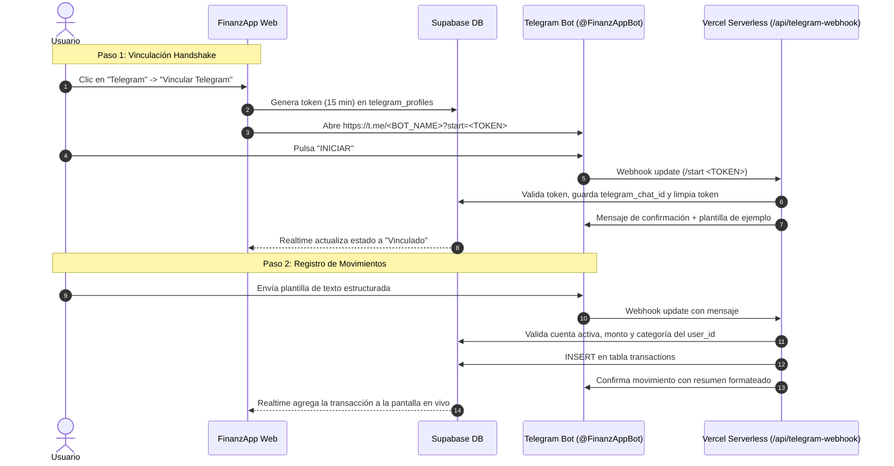

# 🤖 Integración del Bot de Telegram en FinanzApp

Esta guía detalla la arquitectura, configuración y puesta en marcha de la integración multiusuario de FinanzApp con Telegram.

---

## 1. Arquitectura y Flujo de Datos



---

## 2. Variables de Entorno Requeridas

En **Vercel** (Settings ➔ Environment Variables) y en tu archivo local `.env`:

| Variable | Tipo | Descripción | Ejemplo |
|---|---|---|---|
| `TELEGRAM_BOT_TOKEN` | Secreto | Token del Bot obtenido desde BotFather | `7123456789:AAH...` |
| `SUPABASE_SERVICE_ROLE_KEY` | Secreto | Clave Service Role de Supabase (bypasea RLS en el webhook) | `eyJhbGci...` |
| `VITE_SUPABASE_URL` | Público | URL del proyecto Supabase | `https://xxxx.supabase.co` |
| `VITE_SUPABASE_ANON_KEY` | Público | Clave anónima pública de Supabase | `sb_publishable_...` |
| `VITE_TELEGRAM_BOT_NAME` | Opcional | Username del bot sin `@` | `MiFinanzAppBot` |

---

## 3. Configuración del Webhook en Telegram

Una vez desplegada tu aplicación en Vercel, ejecuta la siguiente petición cURL en tu terminal o navegador para indicarle a Telegram a dónde enviar los mensajes:

```bash
curl -F "url=https://<TU-DOMINIO-VERCEL>.vercel.app/api/telegram-webhook" \
     https://api.telegram.org/bot<TU_TELEGRAM_BOT_TOKEN>/setWebhook
```

### Para verificar el estado del webhook:
```bash
curl https://api.telegram.org/bot<TU_TELEGRAM_BOT_TOKEN>/getWebhookInfo
```

---

## 4. Estructura de la Tabla `telegram_profiles` en Supabase

Si deseas revisar las políticas RLS y estructura de la tabla:

```sql
CREATE TABLE IF NOT EXISTS public.telegram_profiles (
  id UUID PRIMARY KEY DEFAULT gen_random_uuid(),
  user_id UUID NOT NULL REFERENCES auth.users(id) ON DELETE CASCADE,
  telegram_chat_id BIGINT UNIQUE,
  first_name TEXT,
  username TEXT,
  link_token TEXT UNIQUE,
  token_expires_at TIMESTAMPTZ,
  created_at TIMESTAMPTZ DEFAULT NOW()
);

-- Habilitar RLS
ALTER TABLE public.telegram_profiles ENABLE ROW LEVEL SECURITY;

-- Política para que el usuario autenticado pueda ver y gestionar su propio perfil
CREATE POLICY "Telegram Profiles Policy"
  ON public.telegram_profiles
  FOR ALL
  USING (auth.uid() = user_id)
  WITH CHECK (auth.uid() = user_id);
```

---

## 5. Comandos Rápidos del Bot

* `/plantilla`: Envía la plantilla en blanco para copiar y rellenar.
* `/cuentas`: Lista los nombres exactos de las cuentas activas del usuario.
* `/categorias`: Lista las categorías y subcategorías disponibles del usuario.
* `/ayuda`: Muestra la guía de uso con ejemplos.

---

## 6. Formato de la Plantilla Determinística (Sin IA)

```text
Tipo: Compra
Cuenta: Corriente Scotiabank
Monto: 14000
Categoria: Alimentación & Gastronomía
Subcategoria: Supermercado
Descripcion: Compras en el Jumbo
Fecha: Hoy
```

### Reglas de Validación:
1. **Cuenta**: Se verifica contra las cuentas del usuario en `accounts`.
2. **Monto**: Admite números simples (`14000`) o con puntos de miles (`14.000` / `14.500.000`). Debe ser mayor a 0.
3. **Fecha**: Admite `Hoy`, `YYYY-MM-DD`, `DD/MM/YYYY` o `DD-MM-YYYY`. Si se omite o es `Hoy`, se asigna la fecha actual en zona horaria de Chile (`America/Santiago`).
4. **Respuesta Rápida**: El endpoint siempre responde con HTTP 200 a Telegram para evitar bucles de reintento.
